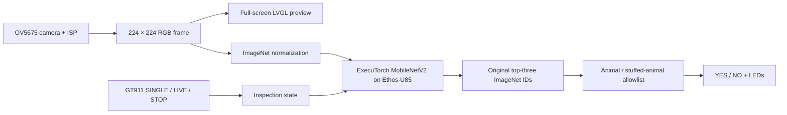

# Alif Industrial Automated Optical Inspection (AOI)

**Edge AI Visual Quality Inspection on the Alif Ensemble E8**

A compact, fully on-device demonstration of an industrial automated optical inspection (AOI) workflow. The **OV5675 camera** acquires images, a quantized **MobileNetV2** runs through **ExecuTorch on the Arm Ethos-U85 NPU**, and the E8 touchscreen and LEDs provide inspection controls and binary results.

> **Demonstration, not production inspection:** The conveyor is simulated by moving objects or photographs manually in front of the camera. There is no motor, encoder, PLC, reject actuator, or machinery emergency-stop control. The current visual rule uses animal/stuffed-animal recognition as a proxy for acceptable parts; it is **not** a defect-trained or industrially validated model.

## Demo at a glance

| Control | On-board behavior | AOI workflow represented |
| --- | --- | --- |
| **SINGLE** | Classify one frame and retain the decision | Indexed / stop-and-inspect station |
| **LIVE** | Repeatedly classify incoming frames, without overlapping inference | Continuous conveyor-style inspection |
| **STOP** | Stop new inference, clear the decision LEDs, show “Break time!”, keep camera preview | Inspection paused (not a safety stop) |

The application starts in STOP. The physical joystick/button remains a backup SINGLE trigger. The LCD currently displays **Animal Detector**, **YES**, and **NO**, not the proposed industrial wording below.

| Current output | Simulated industrial meaning | Indicator |
| --- | --- | --- |
| **YES** | **GOOD / PASS** — an animal-related top-three label is present | Green LED |
| **NO** | **REJECT / FAIL** — no animal-related top-three label is present | Red LED |

The LED feedback is cleared by a subsequent request or after approximately three seconds. In LIVE mode it may appear as pulses. Actual detection accuracy varies with the object, image framing, and lighting.

## Hardware and software

| Component | Purpose |
| --- | --- |
| **Alif Ensemble E8 AI/ML AppKit** (Cortex-M55 HP) | Embedded application platform |
| **OV5675 + ISP** | Camera capture and 224 × 224 RGB input |
| **Arm Ethos-U85 (256 MAC configuration)** | Accelerates delegated MobileNetV2 inference |
| **ExecuTorch** | Model runtime |
| **GT911 touchscreen + LVGL / LCD** | Live preview and SINGLE, LIVE, STOP controls |
| **AppKit LEDs** | Green/red inspection indication |



Camera preview and model preparation use the same 224 × 224 RGB image, but the LCD enlarges and center-crops its preview for the 480 × 800 panel. The model input remains unchanged. Touch and camera share an I²C peripheral; the overlay adapts the touch driver to use the existing serialized camera transport. An inference already running is not preempted by STOP, and touchscreen responsiveness depends on inference timing.

## Model preparation and application-specific adaptation

We began with **TorchVision MobileNetV2, ImageNet-1K V2 weights**, which predicts 1,000 classes. In early board experiments, live-camera predictions were often unreliable, prompting an investigation of preprocessing, quantization and class interpretation.

**1. INT8 calibration.** We exported a separate candidate calibrated with **60 natural photographs**, preserving the pretrained weights and preprocessing. The candidate uses **per-channel INT8 weights**, **per-tensor INT8 activations**, targets `ethos-u85-256`, and uses the `Shared_Sram` configuration. We did **not** fine-tune the neural network.

**2. Sanity checks, not accuracy claims.** On four sample images, FP32, PT2E INT8 and the TOSA reference had the same top-one predictions (4/4 agreement); three of four top-one results matched expected labels. See the [numerical results and provenance](model/RESULTS.md). This is **not** an ImageNet benchmark or proof of compiled-NPU parity. Live-camera recognition improved only slightly in informal testing; output saturation and a camera Bayer-format discrepancy remained investigation items.

**3. Application-level binary decision.** Instead of retraining the network for two classes, the firmware retains all **1,000 logits**, determines the original **top three** labels, and reports YES if **any** of those labels belongs to its explicit animal/stuffed-animal allowlist (zero-based ImageNet IDs `0..397` plus `850` for teddy bear). Otherwise it reports NO. This is a **postprocessing rule**, not a binary model or a calibrated probability threshold. For the AOI simulation, YES maps to **GOOD/PASS** and NO to **REJECT/FAIL**. An animal label among the top three can cause a false YES even when the object is not an animal.

The exact candidate model is **3,470,320 bytes**, with SHA-256:

```text
f468ea2feae405abd7cfb9c0e95a7e9a357fd42698646846dba5ec081411ec7a
```

The exact calibrated `.pte` is **included** at [`model/mv2_cal60_imagenet_v2_ethos-u85-256_shared_sram.pte`](model/mv2_cal60_imagenet_v2_ethos-u85-256_shared_sram.pte). The original calibration photographs are not included and are unnecessary for building with this PTE. See [BUILD.md](BUILD.md) for hash verification, build instructions, reproduction limits, and the unresolved weight-redistribution terms.

## Demonstration

1. Boot the firmware and confirm the camera preview and touch controls. For optional diagnostics, use UART4 at 115200 baud.
2. Present a **teddy bear** or a **dog/cat image on a phone**. Tap **SINGLE** and observe the YES/green response *if* an eligible class appears in the top three.
3. Present a **muffin**, **electric fan**, or another non-animal object. Tap **SINGLE** and observe NO/red *if* no eligible animal class appears in the top three.
4. Select **LIVE** and manually move the demonstration objects across the camera view to simulate continuous inspection.
5. Select **STOP** to pause new classification and display the break message; the camera preview continues.

The test objects illustrate the workflow, not guaranteed predictions. For a hackathon demo, capture a short video showing the touchscreen controls, object changes, and LED indication.

## Source and reproduction

This project lives as an **application overlay** in the organizers' CMSIS-ExecuTorch hackathon repository; it is **not built by the root Pico Faces CMSIS solution**. The application is reconstructed against the separate [Alif ML Embedded Evaluation Kit](https://github.com/alifsemi/alif_ml-embedded-evaluation-kit) (MLEK). The original working project was derived from MLEK revision `d7c39929fe482c1ce17b7be03edfab1db03acf06` with application-specific modifications.

The submission provides:

- `overlay/` — adapted classifier, touchscreen/UI, LED application sources, and model exporter
- `patches/platform-ui.patch` — supporting LVGL/physical-button modifications
- `scripts/prepare.py` and `config/appkit-e8.cmake` — source overlay preparation and build settings
- `dependencies.lock.json`, `source-manifest.json`, `model/manifest.json` — revision, checksum, and provenance records
- `model/RESULTS.md` and `model/validation-summary.json` — recorded numerical results and provenance
- `deployment/` and `licenses/` — SETOOLS template and preserved license notices
- [REPRODUCIBILITY.md](REPRODUCIBILITY.md) — clean-build attempt and validation status
- `SHA256SUMS` — integrity checksums for the submission files

**The primary firmware-build path uses the included original calibrated PTE and verifies its recorded SHA-256.** [BUILD.md](BUILD.md) separates this recommended workflow from optional regeneration of a new model candidate. A regenerated PTE may have a different hash and requires separate validation and an explicit, reviewed model-hash or build-configuration update before acceptance. The guide includes checkout, dependencies, export, build and MRAM deployment commands, plus known blockers. No external-flash image, Flite, or speech subsystem is required.

The project author confirms that the working firmware using the included calibrated model was deployed. The separate clean-build attempt did not reach compilation because dependency downloads failed; it produced no new firmware. See [REPRODUCIBILITY.md](REPRODUCIBILITY.md) for details.

## Limitations and future direction

- The 1,000-class backbone and top-three animal rule are demonstration proxies, not trained defect recognition. False GOOD and false REJECT decisions are possible; no measured industrial accuracy is claimed.
- Touch input, preview and repeated inference contend for embedded processing time. STOP does not immediately cancel an inference already running.
- There is no production conveyor control, object tracking, spatial localization or synchronization with an encoder.
- A future version could use task-specific inspection images, a detector or anomaly model, object tracking, and external I/O for actual inspection cells.

---

*Hackathon submission: Alif Industrial Automated Optical Inspection (AOI) — embedded PASS/FAIL workflow demonstration on Arm Ethos-U85.*
